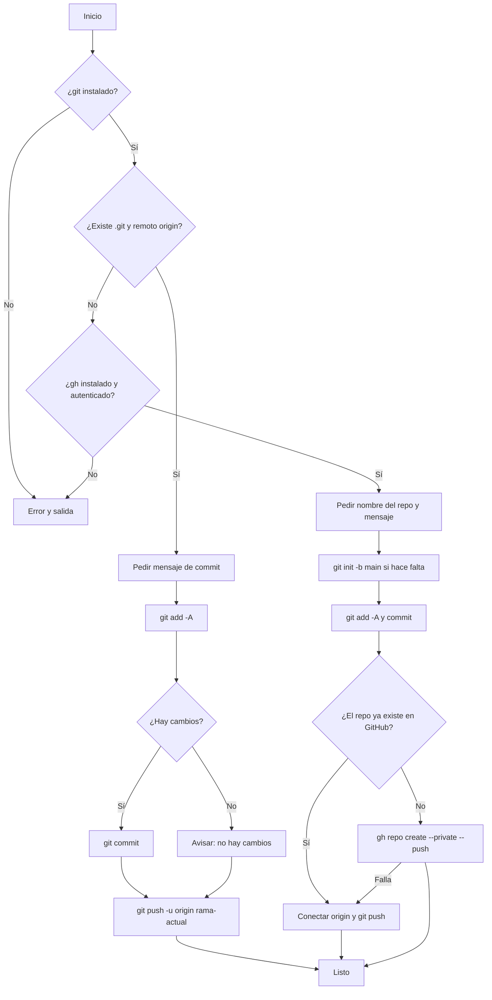

# Automatizaciones

Colección de scripts de automatización con su código fuente y la explicación de cómo funcionan, pensados como material de tutorial.

## Índice

- [Scripts incluidos](#scripts-incluidos)
- [automatizacion_subida_repo.sh](#automatizacion_subida_reposh)
  - [¿Qué hace?](#qué-hace)
  - [Requisitos](#requisitos)
  - [Instalación](#instalación)
  - [Uso](#uso)
  - [Flujo de ejecución](#flujo-de-ejecución)
  - [Explicación del código](#explicación-del-código)
  - [Manejo de errores](#manejo-de-errores)
  - [Notas y límites](#notas-y-límites)
- [Estructura del repositorio](#estructura-del-repositorio)
- [Agregar nuevos scripts](#agregar-nuevos-scripts)

## Scripts incluidos

| Script | Descripción | Dependencias |
| --- | --- | --- |
| [`automatizacion_subida_repo.sh`](automatizacion_subida_repo.sh) | Sube el código de la carpeta actual a GitHub en un solo comando: crea el repositorio si no existe o hace commit y push si ya existe. | `git`, `gh` |

## automatizacion_subida_repo.sh

### ¿Qué hace?

Automatiza el ciclo de subir un proyecto a GitHub. Según el estado de la carpeta desde la que lo ejecutas, hace una de dos cosas:

- **Repositorio ya conectado** (tiene `.git` y un remoto `origin`): hace `git add`, commit con el mensaje que indiques y `git push`.
- **Sin repositorio**: inicializa git, hace el primer commit, crea el repositorio en GitHub (**privado**) y sube el código.

### Requisitos

- [Git](https://git-scm.com/)
- [GitHub CLI (`gh`)](https://cli.github.com/), con la sesión iniciada:

  ```bash
  gh auth login
  ```

  `gh` solo es necesario cuando hay que crear el repositorio.

### Instalación

Dale permisos de ejecución y, opcionalmente, ponlo en tu `PATH` para usarlo desde cualquier proyecto:

```bash
chmod +x automatizacion_subida_repo.sh
sudo cp automatizacion_subida_repo.sh /usr/local/bin/subir-repo
```

### Uso

Ejecútalo **dentro de la carpeta del proyecto** que quieres subir (el script trabaja sobre el directorio actual):

```bash
cd mi-proyecto
subir-repo        # o ./automatizacion_subida_repo.sh si no lo copiaste al PATH
```

Te pedirá:

| Pregunta | Cuándo aparece | Valor por defecto |
| --- | --- | --- |
| `Nombre del repositorio` | Solo si todavía no hay repositorio | Obligatorio |
| `Mensaje del commit` | Siempre | `Primer commit` (repo nuevo) o `Actualizcion <fecha hora>` (repo existente) |

### Flujo de ejecución



### Explicación del código

| Líneas | Qué hace |
| --- | --- |
| `set -euo pipefail` y `trap ... ERR` | Modo estricto: el script se detiene ante cualquier error, variable sin definir o fallo dentro de un pipe, e imprime la línea donde falló. |
| `command -v git` | Verifica que git esté instalado antes de hacer nada. |
| `if [ -d .git ] && git remote get-url origin` | Decide el modo: si la carpeta ya tiene git y un remoto `origin`, solo actualiza. |
| `read -rp ... MSG` y `${MSG:-...}` | Pide el mensaje del commit y usa uno automático si presionas Enter. |
| `git add -A` + `git diff --cached --quiet` | Agrega todo y solo hace commit si realmente hay cambios, evitando commits vacíos. |
| `git push -u origin "$(git branch --show-current)"` | Sube la rama actual y la deja enlazada con el remoto. |
| `command -v gh` y `gh auth status` | En modo creación, comprueba que GitHub CLI esté instalado y con sesión iniciada. |
| `[ -n "$REPO" ]` | El nombre del repositorio es obligatorio. |
| `[ -d .git ] \|\| git init -b main` | Inicializa git con la rama `main` solo si hace falta. |
| `gh api user -q .login` | Obtiene tu usuario de GitHub para armar la URL del repositorio. |
| `gh repo view "$OWNER/$REPO"` | Si el repo ya existe en GitHub, solo lo conecta como `origin` y sube. |
| `gh repo create "$REPO" --private --source=. --remote=origin --push` | Crea el repositorio privado desde la carpeta actual y sube el código. |
| `elif ! gh repo create ...` | Si la creación falla, intenta conectar con el repositorio existente como respaldo. |

### Manejo de errores

- `git` no instalado → mensaje y salida.
- `gh` no instalado o sin sesión → indica ejecutar `gh auth login`.
- Nombre de repositorio vacío → se detiene.
- Cualquier comando que falle → muestra `Error en la linea N. Saliendo...`.

### Notas y límites

- Los repositorios nuevos se crean como **privados**. Para hacerlo público, cambia `--private` por `--public` en el script.
- `git add -A` sube **todo** lo que haya en la carpeta. Revisa que tengas un `.gitignore` y no se suban credenciales, archivos `.env` ni `node_modules`.
- En repos existentes el push va a la rama actual, sea cual sea.
- Requiere un shell Bash (Linux, macOS o WSL).

## Estructura del repositorio

```text
.
├── README.md
└── automatizacion_subida_repo.sh
```

## Agregar nuevos scripts

1. Coloca el script en la raíz del repositorio.
2. Agrega una fila en la tabla de [Scripts incluidos](#scripts-incluidos).
3. Crea una sección con el formato de arriba (qué hace, requisitos, uso y explicación) y enlázala en el [Índice](#índice).
